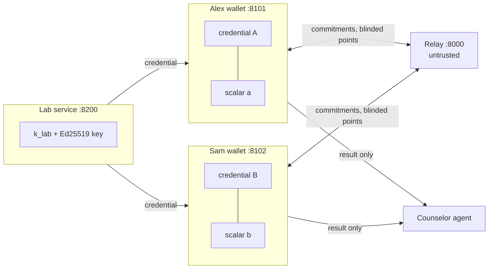
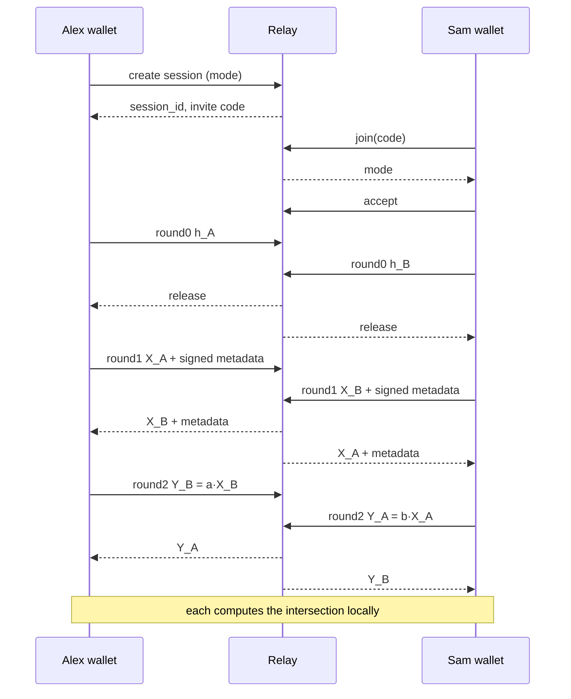

# Design Document

## Overview

Four services and one agent:

- **Lab** issues signed carrier credentials made of lab tokens `T_g = k_lab · H(g)`.
- **Relay** is untrusted. It pairs two wallets, enforces commit-then-reveal, and forwards opaque messages.
- **Wallet** (one per user) holds the credential and a fresh session scalar, runs the PSI, and computes the result locally.
- **Trial verifier** requests and checks one signed claim for clinical-trial eligibility.
- **Counselor agent** turns the result into a plain-language explanation using curated panel facts only.

The protocol is two-party DH-PSI over ristretto255 on lab tokens rather than raw gene IDs. Using lab tokens is what makes the small input domain safe; see "Why lab tokens" below.



## Cryptographic construction

Notation is additive (ristretto255). `H(g) = ristretto255_from_hash(SHA-512("genematch/v1/gene/" || g))`.

1. **Issuance.** The lab samples `k_lab` once. For person P with carrier genes `G_P`, it computes `T_g = k_lab · H(g)` for each g in G_P, sorts the tokens' encodings, and sets `C_P = SHA-256("genematch/v1/commit/" || concat(sorted tokens))`. It signs `canon({person_id, count, commitment: C_P, issued_at})` with Ed25519.
2. **Round 0 (commit).** Alex samples `a`, computes `X_A = shuffle({a · T : T in tokens_A})`, and sends `h_A = SHA-256(canon(X_A))`. Sam does the same with `b`.
3. **Round 1 (reveal).** After the relay holds both commitments, each wallet sends its blinded set plus `{person_id, count, commitment, issued_at, lab_sig}`. The receiver checks the hash against the round-0 commitment, verifies the lab signature, checks `|X| == count <= MAX_SET`, and validates every point.
4. **Round 2 (double-blind).** Alex sends `Y_B = {a · x : x in X_B}` (same order as X_B in Detail mode, shuffled in Count mode). Sam sends `Y_A = {b · x : x in X_A}` likewise.
5. **Result.** Alex receives `Y_A = {b · x : x in X_A} = {ab · T : T in tokens_A}` and already holds `Z_B = {a · x : x in X_B} = {ab · T : T in tokens_B}` (the values he sent in round 2). The intersection is `Y_A ∩ Z_B`. In Detail mode, Y_A keeps the order of Alex's own X_A, so he maps matches back to his genes. In Count mode, Y_A arrives shuffled, so only `|Y_A ∩ Z_B|` is learnable. Sam does the symmetric computation.

Both parties learn the same output because the intersection is symmetric and both rounds use the same mode.

### Why lab tokens (the small-domain attack)

The panel has fewer than 100 genes. With plain DH-PSI on `H(g)`, a malicious partner could put every panel gene into their own set and learn the other person's entire carrier list. Lab tokens block this: computing `T_g` requires `k_lab`, so a partner can only include tokens the lab issued to them, and the signed count caps how many. This is a lightweight version of authorized PSI (Baldi et al., CCS 2011; De Cristofaro and Tsudik).



## Components and interfaces

### core/crypto.py
- `hash_to_group(gene_id: str) -> bytes`
- `random_scalar() -> bytes`
- `mul(scalar: bytes, point: bytes) -> bytes` (validates the point, rejects identity)
- `blind_set(scalar, points) -> list[bytes]`
- `commit_tokens(tokens) -> bytes`, `commit_blinded(points) -> bytes`
- `canon(obj) -> bytes`

### core/protocol.py
- `class Session` holding role, mode, scalar, own tokens, and round state.
- `round0() -> Commitment`, `round1() -> BlindedSet`, `round2(peer: BlindedSet) -> DoubleBlinded`, `result(peer_double: DoubleBlinded) -> Result`
- `verify_peer(peer, lab_pubkey, commitment)` raises `ProtocolError` with a user-safe message.

### lab/service.py
- `POST /credentials {person_id, genes[]} -> Credential`
- `GET /pubkey -> {ed25519_pubkey}`

### relay/service.py (in-memory store)
- `POST /sessions {mode} -> {session_id, invite_code}`
- `POST /sessions/join {invite_code} -> {session_id, mode}`
- `POST /sessions/{id}/accept`
- `POST /sessions/{id}/round/{n} {role, payload}`
- `GET /sessions/{id}/round/{n}?role=` returns the peer payload when releasable, else 204
- `GET /sessions/{id}/log` returns the transparency log (prefixes only)

### wallet/service.py
Serves the UI. Holds the credential (loaded from the seed file) and the live `Session` in memory. It polls the relay and exposes `POST /check/start`, `POST /check/join`, `GET /check/status`, and `GET /check/seen` for the transparency panel.

### agent/counselor.py
- `explain(result: Result, panel: Panel) -> Explanation`
- Input in Count mode: `{shared_count}`. Input in Detail mode: `{shared: [panel entries]}`.
- Output: `{summary, what_it_means, next_steps, questions[], disclaimer}`.
- Bedrock adapter with a strict system prompt ("use only the provided facts; do not diagnose; always refer to a genetic counselor"), with a deterministic template fallback.

## Data models

```json
// Credential
{"person_id": "alex", "tokens": ["<hex>", "..."], "count": 3,
 "commitment": "<hex>", "issued_at": "2026-10-24T09:00:00Z", "lab_sig": "<hex>"}

// Round 1 payload
{"blinded": ["<hex>", "..."], "person_id": "alex", "count": 3,
 "commitment": "<hex>", "issued_at": "...", "lab_sig": "<hex>"}

// Panel entry
{"gene": "CFTR", "condition": "Cystic fibrosis", "inheritance": "AR",
 "summary": "one plain-language line", "medlineplus": "https://..."}
```

## Use case 2: trial eligibility (selective disclosure)

No zero-knowledge proof is needed: the lab signs each finding separately, so a patient can show one finding on its own.

```json
// Signed claim (issued by the lab alongside the PSI tokens)
{"person_id": "alex", "gene": "BRCA1", "finding": "germline pathogenic variant",
 "salt": "<hex>", "holder_pubkey": "<hex>", "issued_at": "...", "lab_sig": "<hex>"}

// Presentation (wallet -> trial verifier)
{"claim": {...}, "trial_id": "parp-demo-01", "nonce": "<hex>", "holder_sig": "<hex>"}
```

- **Trials file:** `data/trials.json` lists demo trials with `trial_id`, a plain-language name, and the required `{gene, finding}`. Use germline findings such as BRCA1/BRCA2, which are realistic eligibility criteria for some PARP-inhibitor trials. Do not use tumor (somatic) mutations, since a germline lab test would not report them.
- **Holder binding:** at setup the wallet generates a holder key and sends its public key to the lab, which embeds it in every claim. Presenting requires a holder signature over the verifier's nonce, so a copied claim is useless without the holder's private key.
- **Salt:** makes each claim's hash unguessable, so a claim hash revealed in one context cannot be matched against guesses.

### trial/service.py (port 8300)
- `GET /` serves the verifier page.
- `POST /requests {trial_id} -> {request_id, nonce, gene, finding, expires_at}`
- `POST /requests/{id}/present {presentation} -> {status, reason}`
- Nonces are single-use and expire after 5 minutes.

### Wallet additions
- `POST /present {request}` shows an approval prompt naming the one finding to be shared, then returns the presentation.

### Limitations
- The same claim shown to two verifiers is linkable, because it is the same signed object. Unlinkable presentation needs BBS+ signatures or a ZK proof; noted as future work.
- The claim reveals the finding itself, which is the point of eligibility, but not anything else.

## Threat model

| Adversary | Can they... | Mitigation |
|---|---|---|
| Relay (honest-but-curious) | Learn genes or result? | Sees only blinded points; scalars never leave wallets; result computed locally. |
| Relay (active) | Swap or replay messages? | Round-0 commitments; lab signatures on metadata. Full channel binding is out of scope for the MVP. |
| Partner (malicious) | Probe all panel genes? | Needs lab tokens (requires `k_lab`); signed count caps set size. |
| Partner | Invent a carrier gene? | Cannot create a valid token without `k_lab`. |
| Partner | Adapt input after seeing mine? | Commit-then-reveal. |
| Partner | Hide a real carrier gene? | **Not prevented in the MVP.** The blinded set is not proven to equal the signed set. See stretch goal S1. |
| Trial verifier | See my other results? | Receives exactly one signed claim; never sees tokens or other claims. |
| Someone with a copied claim | Present it as their own? | Holder signature over a fresh nonce is required. |
| AI agent / LLM provider | Learn genetic data? | In Count mode it receives only a number; in Detail mode it receives only what both partners already learned. |

Residual risks, stated plainly in the README: tokens are deterministic per gene, so two people holding the same gene hold the same token (fine inside wallets, but tokens must never leave them); a compromised lab key breaks everything; the design is not post-quantum.

## Stretch designs

- **S1: Prove no hiding.** Prove in zero knowledge that the blinded set is `{a · T}` for exactly the tokens committed in the signed credential. This needs elliptic-curve operations in-circuit, so the token curve should match the circuit's embedded curve (for example Grumpkin in Noir) rather than ristretto255. It is research-grade for a single day, so treat it as design-only unless ahead of schedule.
- **S2: Yes/no only.** Reveal only whether the count is greater than zero, via circuit-PSI. Design note only.
- **S3: Post-quantum.** Genomic data stays sensitive for life, so harvest-now-decrypt-later is a real threat, and DH-PSI is not quantum-safe. Sketch a path through lattice-based OPRFs in the README.

## Error handling
- All protocol failures raise `ProtocolError(code, user_message)`. The UI shows the user message, for example: "Your partner's results couldn't be verified as coming from the lab, so the check was stopped. Nothing about you was revealed."
- On any abort, the wallet zeroes the scalar and marks the session failed at the relay.

## Testing strategy
- Unit: hash-to-group determinism and domain separation, scalar multiplication commutativity (`a·(b·P) == b·(a·P)`), commitment mismatch detection, signature verification (valid, tampered, wrong key), identity and invalid point rejection.
- Protocol: all three demo couples in both modes produce the expected intersections, and Count mode output contains no gene information.
- Adversarial: inflated set beyond the signed count, an unsigned token, a commitment mismatch, and a replayed round-1 message all abort.
- Trial: valid presentation accepted; tampered claim, wrong holder key, reused nonce, expired nonce, and mismatched gene all rejected; wallet sends exactly one claim.
- Agent: the template fallback satisfies Requirement 6, and a Count-mode prompt contains no gene names (assert on the prompt string).
