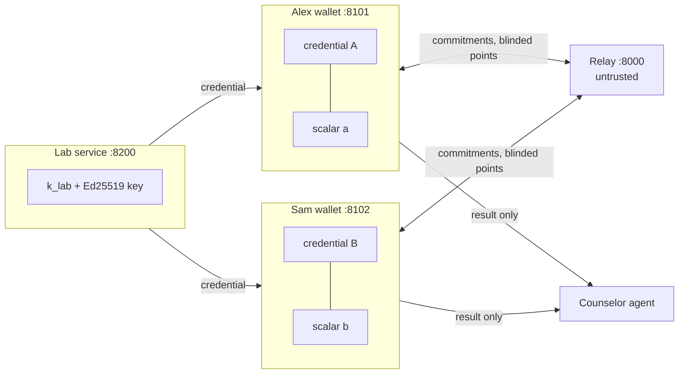
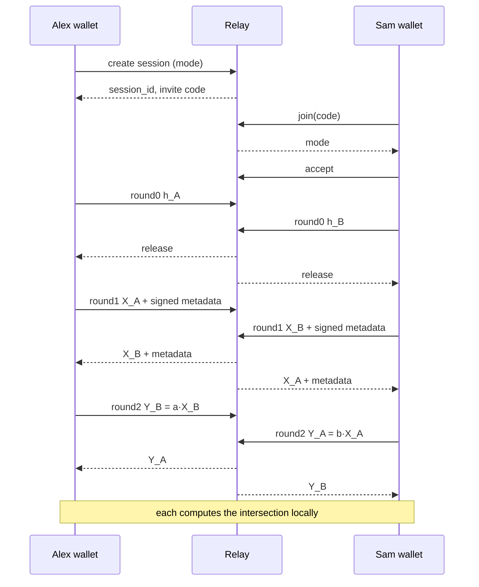

# Design Document

## Overview

Four services and one agent:

- **Lab** issues signed carrier credentials made of lab tokens `T_g = k_lab · H(g)`.
- **Relay** is untrusted. It pairs two wallets, enforces commit-then-reveal, and forwards opaque messages.
- **Wallet** (one per user) holds the credential and a fresh session scalar, runs the PSI, and computes the result locally.
- **Trial verifier** requests and checks one signed claim for clinical-trial eligibility.
- **Counselor agent** turns the result into a plain-language explanation using curated panel facts only.

The protocol is two-party DH-PSI over ristretto255 on lab tokens rather than raw gene IDs. Using lab tokens is what makes the small input domain safe; see "Why lab tokens" below.



## Cryptographic construction

Notation is additive (ristretto255). `H(g) = ristretto255_from_hash(SHA-512("genematch/v1/gene/" || g))`.

1. **Issuance.** The lab samples `k_lab` once. For person P with carrier genes `G_P`, it computes `T_g = k_lab · H(g)` for each g in G_P, sorts the tokens' encodings, and sets `C_P = SHA-256("genematch/v1/commit/" || concat(sorted tokens))`. It signs `b"genematch/v1/credential/" || canon({person_id, count, commitment: C_P, issued_at})` with Ed25519. Requirement 1.2 uses this same prefixed commitment.
2. **Round 0 (commit).** Alex samples `a`, computes `X_A = shuffle({a · T : T in tokens_A})`, and sends `h_A = SHA-256(b"genematch/v1/blinded/" || canon(X_A))`, where `X_A` is encoded as a JSON list of lowercase hex strings. Sam does the same with `b`.
3. **Round 1 (reveal).** After the relay holds both commitments, each wallet sends its blinded set plus `{person_id, count, commitment, issued_at, lab_sig}`. The receiver checks the hash against the round-0 commitment, verifies the lab signature, checks `|X| == count <= MAX_SET`, and validates every point.
4. **Round 2 (double-blind).** Alex sends `Y_B = {a · x : x in X_B}` (same order as X_B in Detail mode, shuffled in Count mode). Sam sends `Y_A = {b · x : x in X_A}` likewise.
5. **Result.** Alex receives `Y_A = {b · x : x in X_A} = {ab · T : T in tokens_A}` and already holds `Z_B = {a · x : x in X_B} = {ab · T : T in tokens_B}` (the values he sent in round 2). The intersection is `Y_A ∩ Z_B`. In Detail mode, Y_A keeps the order of Alex's own X_A, so he maps matches back to his genes. In Count mode, Y_A arrives shuffled, so only `|Y_A ∩ Z_B|` is learnable. Sam does the symmetric computation.

Both parties learn the same output because the intersection is symmetric and both rounds use the same mode.

### Why lab tokens (the small-domain attack)

The panel has fewer than 100 genes. With plain DH-PSI on `H(g)`, a malicious partner could put every panel gene into their own set and learn the other person's entire carrier list. Lab tokens block this: computing `T_g` requires `k_lab`, so a partner can only include tokens the lab issued to them, and the signed count caps how many. This is a lightweight version of authorized PSI (Baldi et al., CCS 2011; De Cristofaro and Tsudik).



## Components and interfaces

### Files, keys, and configuration

| Item | Location | Notes |
|---|---|---|
| Lab keys | `var/lab_keys.json` = `{"k_lab": hex, "ed25519_seed": hex}` | `lab.keys.load_or_create()` creates the file on first use and reuses it afterwards, so seeded credentials stay valid across restarts. Demo only. `var/` is gitignored. |
| Wallet files | `var/wallets/<person_id>.json` = `{"person_id", "genes", "credential", "claims", "holder_seed", "lab_pubkey"}` | Written by `seed_demo.py`, read by the wallet at startup. `genes` is shown only on the owner's home screen and is never sent anywhere. |
| Wallet identity | env `GENEMATCH_PERSON` (for example `alex`), `GENEMATCH_RELAY` (default `http://localhost:8000`), `GENEMATCH_TRIAL` (default `http://localhost:8300`) | Partner A always runs on 8101 and partner B on 8102. |
| Couple choice | `COUPLE=1\|2\|3 ./scripts/run_demo.sh` (default 1) | Starts the wallets for that couple. |
| Counselor | env `BEDROCK_MODEL_ID` (a Claude model enabled in the team's AWS account), `AWS_REGION` (default `us-east-1`) | If `BEDROCK_MODEL_ID` is unset, the template is used. |

**Seeding.** `scripts/seed_demo.py` runs in-process (no HTTP): it loads the lab keys, generates a holder key per person, calls `core.issuance.issue(...)`, and writes the wallet files. In the demo, the seed script generates the holder key on the wallet's behalf and writes it only to that wallet's file; the lab sees only the public key.

**Demo people** (all synthetic):

| Couple | Partner A (8101) | Partner B (8102) | Shared | Trial findings |
|---|---|---|---|---|
| 1: one shared | `alex`: CFTR, GBA, PAH | `sam`: CFTR, HEXA | CFTR | alex: BRCA1 |
| 2: none shared | `jordan`: HBB, SMN1 | `riley`: ASPA, FANCC, PAH | none | none |
| 3: two shared | `casey`: HBB, HEXA, SMN1 | `morgan`: HBB, SMN1, GBA | HBB, SMN1 | morgan: BRCA2 |

Trial findings are separate from the carrier panel. The lab issues claims only for `CLAIM_GENES = {"BRCA1", "BRCA2"}` with finding `"germline pathogenic variant"`.

### core/crypto.py
- `hash_to_group(gene_id: str) -> bytes`
- `random_scalar() -> bytes`
- `mul(scalar: bytes, point: bytes) -> bytes` (validates the point, rejects identity)
- `blind_set(scalar, points) -> list[bytes]`
- `commit_tokens(tokens) -> bytes` = `SHA-256(b"genematch/v1/commit/" || concat(sorted tokens))`
- `commit_blinded(points) -> bytes` = `SHA-256(b"genematch/v1/blinded/" || canon([hex(p) for p in points]))`
- `canon(obj) -> bytes`
- `sign(seed, prefix, obj) -> hex`, `verify(pubkey, prefix, obj, sig) -> bool` (Ed25519 over `prefix || canon(obj)`)

### core/issuance.py
- `issue(k_lab, lab_seed, person_id, genes, findings, holder_pubkey, panel) -> tuple[Credential, list[SignedClaim]]`
- Rejects genes not in the panel, non-AR genes, more than `MAX_SET = 20` genes, and findings outside `CLAIM_GENES`. The lab HTTP endpoint and the seed script both call this.

### core/protocol.py
- `class Session` holding role, mode, scalar, own tokens, and round state.
- `round0() -> Commitment`, `round1() -> BlindedSet`, `round2(peer: BlindedSet) -> DoubleBlinded`, `result(peer_double: DoubleBlinded) -> Result`
- `verify_peer(peer, lab_pubkey, commitment)` raises `ProtocolError` with a user-safe message.
- `zero()` overwrites the scalar; called on completion and on any abort.

### core/claims.py
- `claim_hash(claim) -> hex` = `SHA-256(b"genematch/v1/claim-hash/" || canon(claim))`, including `lab_sig`.
- `make_presentation(claim, holder_seed, nonce, trial_id) -> Presentation`; the holder signs `b"genematch/v1/present/" || canon({claim_hash, nonce, trial_id})`.
- `verify_presentation(p, lab_pubkey, request) -> None` checks the lab signature (prefix `genematch/v1/claim/`, over the claim without `lab_sig`), the holder signature against `claim.holder_pubkey`, that `p.nonce == request.nonce` and `p.trial_id == request.trial_id`, and that gene and finding match. Raises `ProtocolError`. Nonce reuse and expiry are checked by the trial service, which owns the nonce store.

### lab/service.py (port 8200)
- `POST /credentials {person_id, genes[], findings[], holder_pubkey} -> {credential, claims}`
- `GET /pubkey -> {ed25519_pubkey}`

### relay/service.py (port 8000, in-memory store)
- `POST /sessions {mode} -> {session_id, invite_code}`. `session_id` is `secrets.token_hex(16)`; `invite_code` is 8 characters of Crockford base32 from `secrets`, single-use.
- `POST /sessions/join {invite_code} -> {session_id, mode}`. A second join returns 409.
- `POST /sessions/{id}/accept`, `POST /sessions/{id}/decline`, `POST /sessions/{id}/fail {role}`
- `GET /sessions/{id}/state -> {state, mode}`, where state is `waiting | joined | accepted | declined | failed | expired | done`.
- `POST /sessions/{id}/round/{n} {role, payload}` with `n` in 0–2 and role `initiator | joiner`. Rounds are refused before `accepted`.
- `GET /sessions/{id}/round/{n}?role=` returns the peer's payload when releasable, else 204. Release rules: round 0 only once both commitments are in; round 1 only once both commitments are in and the peer posted round 1; round 2 once the peer posted it.
- `GET /sessions/{id}/log -> [{t, role, round, kind, prefixes: [8-hex]}]`
- Sessions and their data are deleted 24 hours after creation.

### wallet/service.py (ports 8101 and 8102)
Serves the UI. Holds the wallet file and the live `Session` in memory. Polls the relay every 500 ms while a check is active. Calls the counselor in-process once a result exists.

| Endpoint | Request | Response |
|---|---|---|
| `GET /me` | | `{person_id, genes, count, claims: [{gene, finding}]}` |
| `POST /check/start` | `{mode}` | `{session_id, invite_code}` |
| `POST /check/join` | `{invite_code}` | `{session_id, mode, mode_text}` (plain-language description of the mode) |
| `POST /check/accept`, `POST /check/decline` | | `{ok}` |
| `GET /check/status` | | `{state, mode, round, result, explanation, error}` |
| `GET /check/seen` | | `{parties: [{party, items: [{label, value}]}]}` |
| `GET /present/pending?request_id=` | | `{trial_name, gene, finding, has_matching_claim}` |
| `POST /present` | `{request_id, approve}` | `{status, reason}` |

- `state` is `idle | waiting_for_partner | awaiting_accept | running | done | failed | declined`. `round` is 0–2 or null. `result` is a `Result` or null, `explanation` an `Explanation` or null, `error` `{code, user_message}` or null.
- `/check/seen` parties are this user, the partner, `relay`, `agent`, and `trial`. The wallet builds it from what it sent (which is what the partner received), what it received, the relay log, the exact counselor input, and the presentations it sent. Points are 8-character hex prefixes; counts are numbers.

### Trial request flow (no CORS needed)
1. The verifier page calls `POST /requests {trial_id}` on its own backend and shows a link: `http://localhost:8101/#present=<request_id>` (and one for 8102).
2. The wallet page reads the fragment and calls its own backend `GET /present/pending`, which fetches `GET {GENEMATCH_TRIAL}/requests/{id}` server-side.
3. The wallet shows an approval prompt naming the single finding. On approve, the wallet backend builds the presentation and posts it to `POST {GENEMATCH_TRIAL}/requests/{id}/present`.
4. The verifier page polls `GET /requests/{id}` until status changes.

### agent/counselor.py
- `explain(result: Result, panel: Panel) -> Explanation`
- Input in Count mode: `{shared_count}`. Input in Detail mode: `{shared: [panel entries]}`.
- `build_prompt(...)` is a separate function so tests can assert the Count-mode prompt contains no gene or condition names.
- Bedrock adapter uses the Converse API through `boto3`, with a strict system prompt ("use only the provided facts; do not diagnose; always refer to a genetic counselor") and a 10-second timeout.
- Falls back to the deterministic template when `BEDROCK_MODEL_ID` is unset, the call raises or times out, or the output fails validation (missing the 25% statement when genes are shared, missing the counselor referral, or fewer than 3 or more than 5 questions).

## Data models

All wire models live in `core/models.py` as Pydantic models. Bytes are lowercase hex strings. `Mode = Literal["count", "detail"]`.

| Model | Fields |
|---|---|
| `Credential` | `person_id, tokens: list[str], count: int, commitment, issued_at, lab_sig` |
| `SignedClaim` | `person_id, gene, finding, salt, holder_pubkey, issued_at, lab_sig` |
| `Commitment` (round 0) | `h` |
| `BlindedSet` (round 1) | `blinded: list[str], person_id, count, commitment, issued_at, lab_sig` |
| `DoubleBlinded` (round 2) | `points: list[str]` |
| `Result` | `mode, shared_count: int, shared_genes: list[str] \| None` (always None in Count mode) |
| `PanelEntry` | `gene, condition, inheritance: Literal["AR"], summary, medlineplus` |
| `Explanation` | `summary, what_it_means, next_steps: list[str], questions: list[str], disclaimer, source: Literal["llm", "template"]` |
| `TrialRequest` | `request_id, trial_id, nonce, gene, finding, expires_at` |
| `Presentation` | `claim: SignedClaim, trial_id, nonce, holder_sig` |

```json
// Credential
{"person_id": "alex", "tokens": ["<hex>", "..."], "count": 3,
 "commitment": "<hex>", "issued_at": "2026-10-24T09:00:00Z", "lab_sig": "<hex>"}

// Round 1 payload
{"blinded": ["<hex>", "..."], "person_id": "alex", "count": 3,
 "commitment": "<hex>", "issued_at": "...", "lab_sig": "<hex>"}

// Panel entry (MedlinePlus Genetics condition page)
{"gene": "CFTR", "condition": "Cystic fibrosis", "inheritance": "AR",
 "summary": "one plain-language line", "medlineplus": "https://medlineplus.gov/genetics/condition/cystic-fibrosis/"}
```

## Use case 2: trial eligibility (selective disclosure)

No zero-knowledge proof is needed: the lab signs each finding separately, so a patient can show one finding on its own.

```json
// Signed claim (issued by the lab alongside the PSI tokens)
{"person_id": "alex", "gene": "BRCA1", "finding": "germline pathogenic variant",
 "salt": "<hex>", "holder_pubkey": "<hex>", "issued_at": "...", "lab_sig": "<hex>"}

// Presentation (wallet -> trial verifier)
{"claim": {...}, "trial_id": "parp-demo-01", "nonce": "<hex>", "holder_sig": "<hex>"}
```

- **Trials file:** `data/trials.json` = `[{trial_id, name, summary, required: {gene, finding}}]`. Use germline findings such as BRCA1/BRCA2, which are realistic eligibility criteria for some PARP-inhibitor trials. Do not use tumor (somatic) mutations, since a germline lab test would not report them.
- **Holder binding:** each claim embeds the holder public key. Presenting requires a holder signature over the verifier's nonce, so a copied claim is useless without the holder's private key.
- **Salt:** 128 random bits from `secrets`; makes each claim's hash unguessable, so a claim hash revealed in one context cannot be matched against guesses.

### trial/service.py (port 8300)
- `GET /` serves the verifier page. `GET /trials` lists `data/trials.json`.
- `POST /requests {trial_id} -> TrialRequest`. Nonce is `secrets.token_hex(16)`.
- `GET /requests/{id} -> {request, status, reason}`, where status is `pending | eligible | rejected`.
- `POST /requests/{id}/present {presentation} -> {status, reason}`. Calls `core.claims.verify_presentation`, then marks the nonce used.
- Nonces are single-use and expire after 5 minutes.

### Limitations
- The same claim shown to two verifiers is linkable, because it is the same signed object. Unlinkable presentation needs BBS+ signatures or a ZK proof; noted as future work.
- The claim reveals the finding itself, which is the point of eligibility, but not anything else.

## Threat model

| Adversary | Can they... | Mitigation |
|---|---|---|
| Relay (honest-but-curious) | Learn genes or result? | Sees only blinded points; scalars never leave wallets; result computed locally. |
| Relay (active) | Swap or replay messages? | Round-0 commitments; lab signatures on metadata. Full channel binding is out of scope for the MVP. |
| Partner (malicious) | Probe all panel genes? | Needs lab tokens (requires `k_lab`); signed count caps set size. |
| Partner | Invent a carrier gene? | Cannot create a valid token without `k_lab`. |
| Partner | Adapt input after seeing mine? | Commit-then-reveal. |
| Partner | Hide a real carrier gene? | **Not prevented in the MVP.** The blinded set is not proven to equal the signed set. See stretch goal S1. |
| Trial verifier | See my other results? | Receives exactly one signed claim; never sees tokens or other claims. |
| Someone with a copied claim | Present it as their own? | Holder signature over a fresh nonce is required. |
| AI agent / LLM provider | Learn genetic data? | In Count mode it receives only a number; in Detail mode it receives only what both partners already learned. |

Residual risks, stated plainly in the README: tokens are deterministic per gene, so two people holding the same gene hold the same token (fine inside wallets, but tokens must never leave them); a compromised lab key breaks everything; the design is not post-quantum.

## Stretch designs

- **S1: Prove no hiding.** Prove in zero knowledge that the blinded set is `{a · T}` for exactly the tokens committed in the signed credential. This needs elliptic-curve operations in-circuit, so the token curve should match the circuit's embedded curve (for example Grumpkin in Noir) rather than ristretto255. It is research-grade for a single day, so treat it as design-only unless ahead of schedule.
- **S2: Yes/no only.** Reveal only whether the count is greater than zero, via circuit-PSI. Design note only.
- **S3: Post-quantum.** Genomic data stays sensitive for life, so harvest-now-decrypt-later is a real threat, and DH-PSI is not quantum-safe. Sketch a path through lattice-based OPRFs in the README.

## Error handling
- All protocol failures raise `ProtocolError(code, user_message)`. Codes: `BAD_SIGNATURE`, `COMMITMENT_MISMATCH`, `COUNT_MISMATCH`, `SET_TOO_LARGE`, `INVALID_POINT`, `PEER_DECLINED`, `SESSION_EXPIRED`, `RELAY_UNAVAILABLE`, and for trials `BAD_LAB_SIG`, `BAD_HOLDER_SIG`, `NONCE_REUSED`, `NONCE_EXPIRED`, `WRONG_FINDING`, `NO_MATCHING_CLAIM`. The UI shows the user message, for example: "Your partner's results couldn't be verified as coming from the lab, so the check was stopped. Nothing about you was revealed."
- On any abort, the wallet zeroes the scalar and marks the session failed at the relay.

## Testing strategy
- Unit: hash-to-group determinism and domain separation, scalar multiplication commutativity (`a·(b·P) == b·(a·P)`), commitment mismatch detection, signature verification (valid, tampered, wrong key), identity and invalid point rejection.
- Protocol: all three demo couples in both modes produce the expected intersections, and Count mode output contains no gene information.
- Adversarial: inflated set beyond the signed count, an unsigned token, a commitment mismatch, and a replayed round-1 message all abort.
- Trial: valid presentation accepted; tampered claim, wrong holder key, reused nonce, expired nonce, and mismatched gene all rejected; wallet sends exactly one claim.
- Agent: the template fallback satisfies Requirement 6, and a Count-mode prompt contains no gene names (assert on the prompt string).
