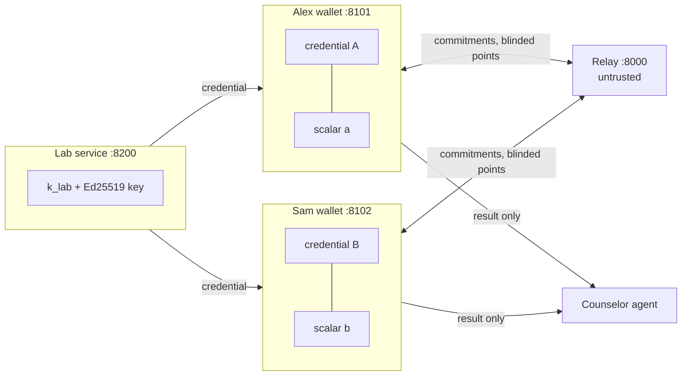
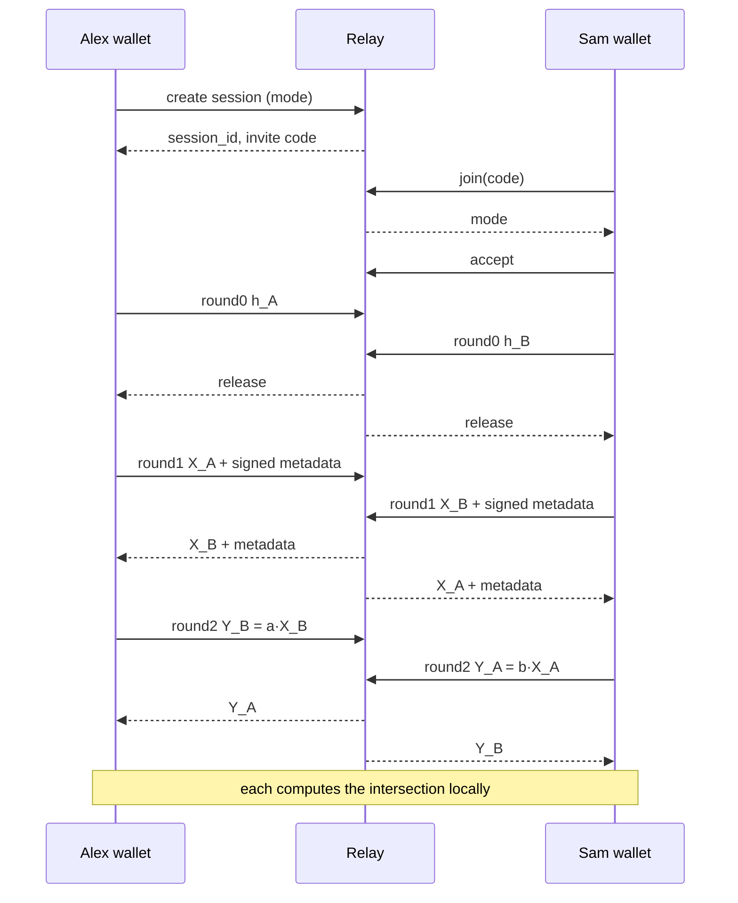

# Design Document

## Overview

Four services and one agent:

- **Lab** issues signed carrier credentials made of lab tokens `T_g = k_lab · H(g)`.
- **Relay** is untrusted. It pairs two wallets, enforces commit-then-reveal, and forwards opaque messages.
- **Wallet** (one per user) holds the credential and a fresh session scalar, runs the PSI, and computes the result locally.
- **Trial verifier** requests and checks one signed claim for clinical-trial eligibility.
- **Counselor agent** turns the result into a plain-language explanation using curated panel facts only.

The protocol is two-party DH-PSI over ristretto255 on lab tokens rather than raw gene IDs. Using lab tokens is what makes the small input domain safe; see "Why lab tokens" below.



## Cryptographic construction

Notation is additive (ristretto255). `H(g) = ristretto255_from_hash(SHA-512("genematch/v1/gene/" || g))`.

1. **Issuance.** The lab samples `k_lab` once. For person P with carrier genes `G_P`, it sorts the genes and computes `T_g = k_lab · H(g)` for each, so `tokens[i]` is the token for `genes[i]` (the wallet relies on this order to map matches back to genes). It sets `C_P = SHA-256("genematch/v1/commit/" || salt || concat(sorted token encodings))`, where `salt` is 16 random bytes from `secrets` when the commitment-salt flag is on (default) and empty when it is off (the off form is byte-identical to the original formula). The salt is stored hex-encoded in `Credential.commit_salt`, stays in the wallet, and is not a signed field. It stops two people with identical carrier sets from having identical, linkable commitments. The lab signs `b"genematch/v1/credential/" || canon({person_id, count, commitment: C_P, issued_at})` with Ed25519; the signature covers the tokens through the commitment. Requirement 1.2 uses this same prefixed commitment.
2. **Round 0 (commit).** Alex samples `a`, computes `X_A = shuffle({a · T : T in tokens_A})`, and sends `h_A = SHA-256(b"genematch/v1/blinded/" || canon({"session_id", "mode", "role", "blinded"}))`, where `blinded` is `X_A` as a JSON list of lowercase hex strings of the raw 32-byte points and `role` is the sender's own role. Binding the session ID, mode, and role defeats a relay that reflects a wallet's own messages back to it, splices or replays messages from another session, or tells the two sides different modes. Sam does the same with `b`.
3. **Round 1 (reveal).** After the relay holds both commitments, each wallet sends its blinded set plus `{person_id, count, commitment, issued_at, lab_sig}`. The receiver recomputes the round-0 hash with its own session ID, its own mode, and the peer's (opposite) role and compares it to the received commitment, then verifies the lab signature, checks `count <= MAX_SET` and `|X| == count`, and validates every point (no identity, no duplicates).
4. **Round 2 (double-blind).** Alex sends `Y_B = {a · x : x in X_B}` (same order as X_B in Detail mode, shuffled in Count mode). Sam sends `Y_A = {b · x : x in X_A}` likewise.
5. **Result.** Alex receives `Y_A = {b · x : x in X_A} = {ab · T : T in tokens_A}` and already holds `Z_B = {a · x : x in X_B} = {ab · T : T in tokens_B}` (the values he sent in round 2). The intersection is `Y_A ∩ Z_B`. In Detail mode, Y_A keeps the order of Alex's own X_A, so he maps matches back to his genes. In Count mode, Y_A arrives shuffled, so only `|Y_A ∩ Z_B|` is learnable. Sam does the symmetric computation.

Both parties learn the same output because the intersection is symmetric and both rounds use the same mode.

## Correctness properties

The crypto core is checked with Hypothesis against the following requirement-linked properties. P6 concerns fresh blinded **point values** on the wire; it does not claim full transcript unlinkability because round 1 deliberately reuses signed credential metadata, as documented under Threat model.

| ID | Property | Requirements verified |
|---|---|---|
| **P1 Correctness** | For any two generated subsets `A` and `B` of the autosomal-recessive gene panel, an honest PSI run reports exactly `A ∩ B`: Detail mode returns the shared genes and Count mode returns exactly their count, never more or less. Both parties receive the same result. | 3.4, 5.5, 5.6 |
| **P2 Commutativity** | For random non-zero canonical scalars `a`, `b` and a random panel gene `g`, `a·(b·H(g)) == b·(a·H(g))`. | 5.5, 5.6 |
| **P3 Order independence** | Shuffling either party's input genes before issuance never changes the PSI result in either mode. | 5.5, 5.6 |
| **P4 Validation** | Every generated 32-byte string that is not a valid ristretto255 encoding is rejected, and the identity is always rejected. | 5.4 |
| **P5 Key separation** | For any panel gene, tokens issued under two distinct non-zero lab keys do not match. | 1.1, 1.4 |
| **P6 Unlinkability** | Two runs over the same non-empty input, using distinct fresh session scalars, produce different blinded point values in their round-1 wire messages. | 5.1, 5.2 |

### Why lab tokens (the small-domain attack)

The panel has fewer than 100 genes. With plain DH-PSI on `H(g)`, a malicious partner could put every panel gene into their own set and learn the other person's entire carrier list. Lab tokens block this: computing `T_g` requires `k_lab`, so a partner can only include tokens the lab issued to them, and the signed count caps how many. This is a lightweight version of authorized PSI (Baldi et al., CCS 2011; De Cristofaro and Tsudik).



## Components and interfaces

### Files, keys, and configuration

| Item | Location | Notes |
|---|---|---|
| Lab keys | `var/lab_keys.json` = `{"k_lab": hex, "ed25519_seed": hex}` | `lab.keys.load_or_create()` creates the file on first use and reuses it afterwards, so seeded credentials stay valid across restarts. Demo only. `var/` is gitignored. |
| Wallet files | `var/wallets/<person_id>.json` = `{"person_id", "genes", "credential", "claims", "holder_seed", "lab_pubkey"}` | Written by `seed_demo.py`, read by the wallet at startup. `genes` is shown only on the owner's home screen and is never sent anywhere. `genes` must be in the same (sorted) order as `credential.tokens`. `credential` is the full `Credential.model_dump()`, including `commit_salt`. |
| Commitment salt flag | env `GENEMATCH_COMMIT_SALT` (`1` default, `0` to turn off) | Read by the lab service and seed script and passed to `issue(..., salt_commitment=...)`. `core/` reads no environment variables. |
| Wallet identity | env `GENEMATCH_PERSON` (for example `alex`), `GENEMATCH_RELAY` (default `http://localhost:8000`), `GENEMATCH_TRIAL` (default `http://localhost:8300`) | Partner A always runs on 8101 and partner B on 8102. |
| Couple choice | `COUPLE=1\|2\|3 ./scripts/run_demo.sh` (default 1) | Starts the wallets for that couple. |
| Counselor | env `BEDROCK_MODEL_ID` (a Claude model enabled in the team's AWS account), `AWS_REGION` (default `us-east-1`) | If `BEDROCK_MODEL_ID` is unset, the template is used. |

**Seeding.** `scripts/seed_demo.py` runs in-process (no HTTP): it loads the lab keys, generates a holder key per person, calls `core.issuance.issue(...)`, and writes the wallet files. In the demo, the seed script generates the holder key on the wallet's behalf and writes it only to that wallet's file; the lab sees only the public key.

**Demo people** (all synthetic):

| Couple | Partner A (8101) | Partner B (8102) | Shared | Trial findings |
|---|---|---|---|---|
| 1: one shared | `alex`: CFTR, GBA, PAH | `sam`: CFTR, HEXA | CFTR | alex: BRCA1 |
| 2: none shared | `jordan`: HBB, SMN1 | `riley`: ASPA, FANCC, PAH | none | none |
| 3: two shared | `casey`: HBB, HEXA, SMN1 | `morgan`: HBB, SMN1, GBA | HBB, SMN1 | morgan: BRCA2 |

Trial findings are separate from the carrier panel. The lab issues claims only for `CLAIM_GENES = {"BRCA1", "BRCA2"}` with finding `"germline pathogenic variant"`.

### core/crypto.py
- `hash_to_group(gene_id: str) -> bytes`
- `random_scalar() -> bytearray` (a mutable buffer so it can be zeroed in place)
- `validate_point(p: bytes) -> bytes`: 32 bytes, a valid ristretto255 encoding, and not the identity (`bytes(32)`, which libsodium's `is_valid_point` accepts); else `ProtocolError("INVALID_POINT")`
- `mul(scalar, point: bytes) -> bytes` (validates the point, rejects identity input and output)
- `blind_set(scalar, points) -> list[bytes]`
- `commit_tokens(tokens: list[bytes], salt: bytes | None = None) -> bytes` = `SHA-256(b"genematch/v1/commit/" || (salt or b"") || concat(sorted tokens))`. `salt` must be exactly 16 raw bytes (not the stored hex string).
- `commit_blinded(points: list[bytes], *, session_id, mode, role) -> bytes` = `SHA-256(b"genematch/v1/blinded/" || canon({"session_id", "mode", "role", "blinded": [hex(p) for p in points]}))`. Input is raw points; `canon` runs over their lowercase hex list, so nothing is hex-encoded twice.
- `canon(obj) -> bytes`
- `sign(seed, prefix, obj) -> hex`, `verify(pubkey, prefix, obj, sig) -> bool` (Ed25519 over `prefix || canon(obj)`; `verify` never raises)

### core/issuance.py (owned by P1)
- `issue(k_lab, lab_seed, person_id, genes, findings, holder_pubkey, panel, *, salt_commitment=True, now=None) -> tuple[Credential, list[SignedClaim]]`
- Rejects (with `IssuanceError`) genes not in the panel, non-AR genes, duplicate genes, more than `MAX_SET = 20` genes, findings outside `CLAIM_GENES`, and finding text other than `"germline pathogenic variant"`. The lab HTTP endpoint and the seed script both call this.
- `credential_signed_fields(cred)` and `claim_signed_fields(claim)` return the exact signed objects, shared by issuance and verification.

### core/protocol.py
- `class Session(role, mode, session_id, credential, genes, lab_pubkey)` holding the scalar, own tokens, and round state.
- The constructor checks the wallet's own credential before anything is sent, in this order: lab signature, `len(genes) == count == len(tokens)`, genes sorted and unique, `commit_salt` decodes to exactly 16 bytes if present, every token is a valid point, and `commit_tokens(tokens, salt)` equals `commitment` (constant-time compare). Any failure raises `ProtocolError("BAD_CREDENTIAL")`, with an internal `reason` that is never shown to the user.
- `round0() -> Commitment`, `receive_commitment(c: Commitment)`, `round1() -> BlindedSet`, `round2(peer: BlindedSet) -> DoubleBlinded`, `result(peer_double: DoubleBlinded) -> Result`
- State order: `NEW → COMMITTED (round0) → PEER_COMMITTED (receive_commitment) → REVEALED (round1) → DOUBLE_SENT (round2) → DONE (result)`. A call out of order raises `OUT_OF_ORDER`. Any error moves to `FAILED`.
- `verify_peer(peer)` uses the stored peer commitment and the constructor's `lab_pubkey`; checks in order: commitment (`COMMITMENT_MISMATCH`), lab signature (`BAD_SIGNATURE`), `count <= MAX_SET` (`SET_TOO_LARGE`), `|X| == count` (`COUNT_MISMATCH`), points valid and distinct (`INVALID_POINT`). `result` also checks `|Y| ==` own count and that every point is valid.
- `zero()` overwrites the scalar in place and clears intermediate state; called on completion and on any abort. Best-effort in Python, because the binding call makes a temporary `bytes` copy.
- `transcript() -> dict` lists what was sent and received, as 8-character hex prefixes and counts only, for `/check/seen`.

Wallet call sequence (P2): `s = Session(...)`; post `s.round0()` to round 0; when the peer's round 0 is released, `s.receive_commitment(...)`; post `s.round1()`; when the peer's round 1 arrives, post `s.round2(peer)`; when the peer's round 2 arrives, `s.result(peer_double)`. On `ProtocolError e`, show `{code: e.code, user_message: e.user_message}` and call `POST /sessions/{id}/fail`.

### core/claims.py
- `claim_hash(claim) -> hex` = `SHA-256(b"genematch/v1/claim-hash/" || canon(claim))`, including `lab_sig`.
- `make_presentation(claim, holder_seed, nonce, trial_id) -> Presentation`; the holder signs `b"genematch/v1/present/" || canon({claim_hash, nonce, trial_id})`. Refuses if the seed's public key is not `claim.holder_pubkey`.
- `verify_presentation(p, lab_pubkey, request) -> None` checks, in order, the lab signature (prefix `genematch/v1/claim/`, over the claim without `lab_sig`; `BAD_LAB_SIG`), the holder signature against `claim.holder_pubkey` (`BAD_HOLDER_SIG`), that `p.nonce == request.nonce` and `p.trial_id == request.trial_id` (`REQUEST_MISMATCH`), and that gene and finding match (`WRONG_FINDING`). Raises `ProtocolError`. Nonce reuse and expiry are checked by the trial service, which owns the nonce store.
- `select_claim(claims, gene, finding) -> SignedClaim` returns exactly one matching claim or raises `NO_MATCHING_CLAIM`.

### lab/service.py (port 8200)
- `POST /credentials {person_id, genes[], findings[], holder_pubkey} -> {credential, claims}`. Returns 403 unless `GENEMATCH_LAB_OPEN=1`. It is unauthenticated, and an open endpoint lets anyone mint tokens for any genes and probe a partner for them, which defeats the point of lab tokens. The seed script issues in-process and does not need it. Never enable it on a deployed service.
- `GET /pubkey -> {ed25519_pubkey}`

### relay/service.py (port 8000, in-memory store)
- `POST /sessions {mode} -> {session_id, invite_code}`. `session_id` is `secrets.token_hex(16)`; `invite_code` is 8 characters of Crockford base32 from `secrets`, single-use.
- `POST /sessions/join {invite_code} -> {session_id, mode}`. A second join returns 409.
- `POST /sessions/{id}/accept`, `POST /sessions/{id}/decline`, `POST /sessions/{id}/fail {role}`
- `GET /sessions/{id}/state -> {state, mode}`, where state is `waiting | joined | accepted | declined | failed | expired | done`.
- `POST /sessions/{id}/round/{n} {role, payload}` with `n` in 0–2 and role `initiator | joiner`. Rounds are refused before `accepted`.
- `GET /sessions/{id}/round/{n}?role=` returns the peer's payload when releasable, else 204. Release rules: round 0 only once both commitments are in; round 1 only once both commitments are in and the peer posted round 1; round 2 only once **both** sides posted round 2, so neither can read the other's double-blinded points first and copy or reorder them. Returns 409 once the session is `failed` or `declined`.
- `GET /sessions/{id}/log -> [{t, role, round, kind, prefixes: [8-hex], meta?}]`. Round-1 entries add `meta = {person_id, count, issued_at, commitment: 8-hex, lab_sig: 8-hex}`, the signed metadata the relay also receives (Req 7.1).
- Sessions and their data are deleted 24 hours after creation.
- Resource caps: request bodies over 16 KB return 413; round payloads may have at most 8 fields, each an int, a string of at most 256 characters, or a list of at most `MAX_SET` such strings (413 or 422 otherwise); at most 10,000 live sessions (503 when full).

### wallet/service.py (ports 8101 and 8102)
Serves the UI. Holds the wallet file and the live `Session` in memory. Polls the relay every 500 ms while a check is active. Calls the counselor in-process once a result exists, and sets `state` to `done` only after the explanation (or its failure) is recorded.

- CSRF guard: POST requests are refused with 403 `FORBIDDEN_ORIGIN` if they carry an `Origin` other than the wallet's own, or `Sec-Fetch-Site: cross-site`. Browsers send cross-site form and `text/plain` posts without CORS preflight, so without this any web page could accept a check on the user's behalf (Req 3.2). The wallet UI must call its own backend from its own origin.
- When the relay reports `failed`, the wallet shows `PEER_FAILED`. On any abort, including unexpected errors, it posts `/fail` so the partner stops waiting. Unexpected errors are logged by type name only.

| Endpoint | Request | Response |
|---|---|---|
| `GET /me` | | `{person_id, genes, count, claims: [{gene, finding}]}` |
| `POST /check/start` | `{mode}` | `{session_id, invite_code}` |
| `POST /check/join` | `{invite_code}` | `{session_id, mode, mode_text}` (plain-language description of the mode; in both modes it also states that each partner learns the other's total carrier count) |
| `POST /check/accept`, `POST /check/decline` | | `{ok}` |
| `GET /check/status` | | `{state, mode, round, result, explanation, error}` |
| `GET /check/seen` | | `{parties: [{party, items: [{label, value}]}]}` |
| `GET /present/pending?request_id=` | | `{trial_name, gene, finding, has_matching_claim}` |
| `POST /present` | `{request_id, approve}` | `{status, reason}` |

- `state` is `idle | waiting_for_partner | awaiting_accept | running | done | failed | declined`. `round` is 0–2 or null. `result` is a `Result` or null, `explanation` an `Explanation` or null, `error` `{code, user_message}` or null.
- `/check/seen` lists, for this user, the partner, and the relay, the round-1 signed metadata as well as the points: person ID, carrier count, and issue time as sent, and the credential commitment and lab signature as 8-hex prefixes. Relay values come from the relay log and are untrusted; the UI renders them as text.
- `/check/seen` parties are this user, the partner, `relay`, `agent`, and `trial`. The wallet builds it from what it sent (which is what the partner received), what it received, the relay log, the exact counselor input, and the presentations it sent. Points are 8-character hex prefixes; counts are numbers.

### Trial request flow (no CORS needed)
1. The verifier page calls `POST /requests {trial_id}` on its own backend and shows a link: `http://localhost:8101/#present=<request_id>` (and one for 8102).
2. The wallet page reads the fragment and calls its own backend `GET /present/pending`, which fetches `GET {GENEMATCH_TRIAL}/requests/{id}` server-side.
3. The wallet shows an approval prompt naming the single finding. On approve, the wallet backend builds the presentation and posts it to `POST {GENEMATCH_TRIAL}/requests/{id}/present`.
4. The verifier page polls `GET /requests/{id}` until status changes.

### agent/counselor.py
- `explain(result: Result, panel: Panel) -> Explanation`
- Input in Count mode: `{shared_count}`. Input in Detail mode: `{shared: [panel entries]}`.
- `build_prompt(...)` is a separate function so tests can assert the Count-mode prompt contains no gene or condition names.
- **Current build: template only.** `explain()` returns the deterministic template (`source: "template"`). No LLM or AWS code exists. `counselor.py` has a marked `LLM HOOK` (`_llm_explain`, returning None) where a model call can be added later; `explain()` already validates any LLM output (`valid()`: 25% statement and "options" when genes are shared, "not zero" and "not tested" when none are, a counselor referral, 3–5 questions, a disclaimer) and falls back to the template on failure.
- **Optional feature.** Deleting `agent/` makes the wallet return `explanation: null`; the UI's counselor code lives only in `wallet/static/counselor.js`, loaded by one removable `<script>` tag. The required safety text (25% risk, options exist, see a genetic counselor, lower-not-zero, not a diagnosis) is static in `app.js`, so it stays when the counselor is removed. A test runs a full check with the counselor removed.

### Wallet UI (`wallet/static/`, plain HTML/CSS/JS)
- Pages: `/` public landing (`wallet/static/index.html`), `/signin` (`wallet/static/signin.html`), `/app` protected (`wallet/pages/app.html`, outside the static mount so it can't be fetched without a session). Static JS/CSS is public and holds no data.
- Screens inside `/app`: home (synthetic-data label, own genes "visible only to you", trial findings, Connect your lab, Add your lab file), onboarding when the wallet is empty, start, join with consent, running, result, failed, declined, trial approval (`#present=<id>`), lab-file confirm.
- Plain language only on default screens (Req 10). Steps: "Sealing your list" (round 0), "Exchanging scrambled lists" (round 1), "Comparing" (round 2); status "Checking privately…" and "Done".
- Result screen: the answer, a line restating the agreed mode, the static safety text, the optional counselor block, and a collapsed `<details>` "Privacy details" holding "What did everyone see?" (cards for You, Your partner, Relay server, plus Counselor and Trial site when they have items), rendered by `privacy.js` and loaded when first opened. Technical terms are allowed only there. Calm neutral colours only.
- Trial links from the verifier (`/#present=<id>`) are forwarded by the landing page to `/app#present=<id>`; the fragment survives the sign-in redirect and the sign-in page returns to it.
- Polling: every 3 s while waiting for the partner (no timeout, since joining may happen later); every 500 ms while running, with a 60 s timeout and a plain message; stops on `done`, `failed`, `declined`; pauses while the tab is hidden; after 3 network failures it stops and says the wallet can't be reached.
- Trial approval names the requester and the finding ("<trial> is asking to verify your <gene> <finding> finding"), lists what will and won't be shared, and notes that sharing the same finding with two trials is linkable.
- All server values are rendered with `textContent`; tests check there are no HTML-injection sinks.

### Demo accounts and sessions (`wallet/auth.py`)
- One person per wallet port (decision 1a). `seed_demo.py` writes `var/accounts.json` = `{person_id: {email, display_name, port, salt, hash, n, r, p}}` with `hashlib.scrypt` (n=2^14, r=8, p=1, 16-byte salt from `secrets`). Demo emails are `<person>@genematch.demo` and demo passwords `demo-<person>`, shown on the sign-in page and labelled as demo. No genetic data is stored with accounts.
- `POST /auth/signin {email, password}`: verifies with `hmac.compare_digest`. Wrong password and unknown email both return 401 `BAD_LOGIN`. Valid credentials for another person return 403 `WRONG_WALLET`: "This wallet belongs to Alex. Open Sam's wallet at localhost:8102." `POST /auth/demo` signs in as this wallet's person ("Continue as Alex"). `POST /auth/signout` deletes the session. `GET /auth/session -> {signed_in, person_id, display_name}`.
- Sessions: `secrets.token_urlsafe(32)`, in memory per wallet process, 8-hour lifetime. Cookie `gm_session_<person>`: HttpOnly, SameSite=Lax, Path=/, no `Secure` (demo runs on http://localhost). Cookies on localhost ignore the port, so the per-wallet name keeps 8101 and 8102 from overwriting each other. The existing Origin check still guards every POST (SameSite does not separate ports).
- Protected: `/me`, `/check/*`, `/present*`, `/onboard/*` return 401 `SIGNED_OUT` without a session; `/app` redirects (303) to `/signin`. Public: `/`, `/signin`, `/auth/*`, static assets.
- Demo-grade only: no rate limiting, no account lockout, in-memory sessions.

### Onboarding: Connect your lab and lab files
- **Empty wallets.** A wallet file may have `credential: null` (written by `seed_demo.py --empty <person>`). `/me` then returns `has_results: false` and `/check/start` and `/check/join` refuse with `NO_RESULTS`. The pinned `lab_pubkey` is always written by the seed script, never taken from an uploaded file.
- **Lab records.** `data/lab_records.json` = `{person_id: {display_name, genes, findings}}` holds the demo lab's synthetic results. `seed_demo.py` and the lab's Connect flow both issue from it.
- **Lab file format** (`core/labfile.py`): `{format: "genematch-lab-file/v1", synthetic: true, person_id, display_name, genes, credential, genes_sig}`. `genes_sig` is an Ed25519 lab signature with the new prefix `b"genematch/v1/lab-file/"` over `canon({format, person_id, display_name, genes, count, commitment, issued_at})`. It binds the plain gene names to the credential's commitment, so a tampered gene list is detected (the credential signature alone covers tokens, not names). No existing contract changes.
- `verify_lab_file(doc, lab_pubkey, person_id)` checks, in order: format (`NOT_LAB_FILE`), schema (`MALFORMED_FILE`), credential lab signature (`NOT_SIGNED`: "This file isn't signed by the lab."), gene-list signature and `doc.person_id == credential.person_id` (`TAMPERED`: "This file was changed after the lab signed it."), person (`WRONG_PERSON`: "This file belongs to <display_name>."), then the `Session` owner-side check (`TAMPERED`). Raises `LabFileError(code, user_message)`.
- `verify_connect_claims(claims, lab_pubkey, person_id, holder_pubkey)` checks every claim's lab signature, person, and holder key.
- **Connect your lab.** Lab endpoints (always on, issue only from lab records):
  - `POST /connect/requests {person_id, holder_pubkey, return_url} -> {request_id, consent_url, collect_token}`. `return_url` must be `http(s)://localhost|127.0.0.1:<port>/app` (allowed hosts configurable for tests). Requests expire after 10 minutes, in memory.
  - `GET /connect/{id}` is the lab's own consent page (server-rendered, escaped): "GeneMatch Demo Lab wants to send your carrier results to this wallet", the person's display name, how many results and findings, and a synthetic-data label. Approve and Decline are plain form posts.
  - `POST /connect/{id}/approve` issues `{lab_file, claims}` with the wallet's holder public key, then 303 to `return_url#connect=<id>`. `POST /connect/{id}/decline` 303 to `return_url#connect-declined`.
  - `GET /connect/{id}/result` with header `X-Collect-Token` (compared in constant time; the token never appears in a URL) returns the issued result once, then deletes it; 202 while pending, 409 if declined, 404 otherwise.
  - Wallet: `POST /onboard/connect` generates a fresh holder seed (kept in memory only until the result is collected), creates the request, and returns `{consent_url}`. `POST /onboard/connect/finish {request_id}` collects server-side, runs `verify_lab_file` and `verify_connect_claims`, then replaces the credential, genes, claims, and holder seed in the wallet file.
- **Add your lab file.** Wallet `POST /onboard/upload` takes the raw file bytes (no multipart), at most 100 KB (413 `FILE_TOO_LARGE`). Non-JSON is checked for raw DNA formats (FASTQ `@`/`+` lines, VCF `##fileformat=VCF`, consumer exports with `rsid` columns, gzip) and rejected with `RAW_DNA`: results must come from a lab so nobody can fake them; other non-JSON gets `NOT_LAB_FILE`. A valid file is held as a pending replacement and the response `{pending_id, display_name, genes, count, replaces, current_count}` drives the "Replace your current results?" confirmation. `POST /onboard/upload/confirm {pending_id}` applies it (pending items expire after 10 minutes). Existing claims and holder seed are kept. Replacement is refused while a check is running or waiting.
- **Lab sign-in** (`lab/auth.py`, passwords via `core/passwords.py`, shared with the wallet). `seed_demo.py` writes `var/lab_accounts.json`: one patient account per synthetic person (`<person>@lab.genematch.demo` / `lab-<person>`) and one staff account (`staff@lab.genematch.demo` / `lab-staff`), scrypt-hashed. Cookie `gm_lab_session` (HttpOnly, SameSite=Lax, 8 hours, in memory). Every lab POST passes the wallet's Origin rule. `GET /signin?next=` and `POST /signin` (form); `next` must be `/connect/<id>`, `/my-results` or `/staff/records`, anything else falls back to `/my-results`. `POST /signout`. Demo credentials are printed on the lab sign-in page unless `GENEMATCH_SHOW_DEMO_LOGINS=0`.
- **Connect consent requires the patient.** `GET /connect/{id}` redirects to sign-in when signed out. It shows the consent page only to the patient whose `person_id` the request names; another patient or a staff account gets a 403 page ("You're signed in to the lab as Sam. This wallet belongs to Alex.") with a sign-out button. `POST /connect/{id}/approve|decline` enforce the same rule (401 signed out, 403 otherwise). The lab issues only that person's own record. Creating a request stays open (the wallet calls it server-side), because nothing is released without the patient's lab sign-in.
- **Download your results file** (patients): `GET /my-results` shows the signed-in patient's own synthetic record; `GET /my-results/file` returns a lab-signed carrier file for that record only. There is no way for a patient to choose genes.
- **Patient records** (lab staff only): `GET /staff/records` lists each synthetic patient with AR gene checkboxes from `panel.json`; `POST /staff/records/{person}` validates with the `issue()` checks and saves to `var/lab_records.json`, an overlay on `data/lab_records.json` that `seed_demo.py` deletes so a reseed resets the demo. Findings are not editable there.
- Script: `scripts/make_lab_file.py --person alex --genes CFTR,HBB --out alex.json [--name "Alex"]` is lab-side tooling. It signs with `var/lab_keys.json` directly, so running it is equivalent to being the lab.
- Wallet `/me` adds `lab_portal` (env `GENEMATCH_LAB_PUBLIC`, default `http://localhost:8200`) so the upload screen can link to "Download your results file".

## Data models

All wire models live in `core/models.py` as Pydantic models. Bytes are lowercase hex strings. `Mode = Literal["count", "detail"]`.

| Model | Fields |
|---|---|
| `Credential` | `person_id, tokens: list[str], count: int, commitment, issued_at, lab_sig, commit_salt: str \| None = None` (salt is wallet-only, never sent) |
| `SignedClaim` | `person_id, gene, finding, salt, holder_pubkey, issued_at, lab_sig` |
| `Commitment` (round 0) | `h` |
| `BlindedSet` (round 1) | `blinded: list[str], person_id, count, commitment, issued_at, lab_sig` |
| `DoubleBlinded` (round 2) | `points: list[str]` |
| `Result` | `mode, shared_count: int, shared_genes: list[str] \| None` (always None in Count mode) |
| `PanelEntry` | `gene, condition, inheritance: Literal["AR"], summary, medlineplus` |
| `Explanation` | `summary, what_it_means, next_steps: list[str], questions: list[str], disclaimer, source: Literal["llm", "template"]` |
| `TrialRequest` | `request_id, trial_id, nonce, gene, finding, expires_at` |
| `Presentation` | `claim: SignedClaim, trial_id, nonce, holder_sig` |

```json
// Credential
{"person_id": "alex", "tokens": ["<hex>", "..."], "count": 3,
 "commitment": "<hex>", "issued_at": "2026-10-24T09:00:00Z", "lab_sig": "<hex>"}

// Round 1 payload
{"blinded": ["<hex>", "..."], "person_id": "alex", "count": 3,
 "commitment": "<hex>", "issued_at": "...", "lab_sig": "<hex>"}

// Panel entry (MedlinePlus Genetics condition page)
{"gene": "CFTR", "condition": "Cystic fibrosis", "inheritance": "AR",
 "summary": "one plain-language line", "medlineplus": "https://medlineplus.gov/genetics/condition/cystic-fibrosis/"}
```

## Use case 2: trial eligibility (selective disclosure)

No zero-knowledge proof is needed: the lab signs each finding separately, so a patient can show one finding on its own.

```json
// Signed claim (issued by the lab alongside the PSI tokens)
{"person_id": "alex", "gene": "BRCA1", "finding": "germline pathogenic variant",
 "salt": "<hex>", "holder_pubkey": "<hex>", "issued_at": "...", "lab_sig": "<hex>"}

// Presentation (wallet -> trial verifier)
{"claim": {...}, "trial_id": "parp-demo-01", "nonce": "<hex>", "holder_sig": "<hex>"}
```

- **Trials file:** `data/trials.json` = `[{trial_id, name, summary, required: {gene, finding}}]`. Use germline findings such as BRCA1/BRCA2, which are realistic eligibility criteria for some PARP-inhibitor trials. Do not use tumor (somatic) mutations, since a germline lab test would not report them.
- **Holder binding:** each claim embeds the holder public key. Presenting requires a holder signature over the verifier's nonce, so a copied claim is useless without the holder's private key.
- **Salt:** 128 random bits from `secrets`; makes each claim's hash unguessable, so a claim hash revealed in one context cannot be matched against guesses.

### trial/service.py (port 8300)
- `GET /` serves the verifier page (a placeholder until `trial/static/index.html` exists). `GET /trials` lists `data/trials.json`, falling back to two built-in demo trials (BRCA1, BRCA2) if the file is missing. Only trials whose required gene is in `CLAIM_GENES` are listed.
- `POST /requests {trial_id} -> TrialRequest`. `request_id` and nonce are `secrets.token_hex(16)`; `gene` and `finding` come from the trial's `required`; `expires_at` is 5 minutes after creation.
- `GET /requests/{id} -> {request, status, code, reason, received}`, where status is `pending | eligible | rejected`, `code` is the `ProtocolError` code or null, `reason` is the plain-language message ("Eligible — verified by lab" when eligible), and `received` is `{claims: 0|1, gene, finding}` so the verifier page can show it received exactly one claim. A pending request past its expiry reads as `rejected` / `NONCE_EXPIRED`.
- `POST /requests/{id}/present {presentation} -> {status, code, reason}`. Order: request must exist (404), nonce not already used (`NONCE_REUSED`), not expired (`NONCE_EXPIRED`), then `core.claims.verify_presentation`. The nonce is marked used on every attempt that reaches verification, valid or not, so each request accepts exactly one presentation.
- Nonces are single-use and expire after 5 minutes. The request store is in memory.
- The lab public key comes from `create_app(lab_pubkey=...)` in tests, else env `GENEMATCH_LAB_PUBKEY`, else `GET {GENEMATCH_LAB}/pubkey` (default `http://localhost:8200`), fetched once and cached. The trial service never reads the lab's key file.

### Wallet presentation endpoints
- `GET /present/pending?request_id=` validates `request_id` as 32 lowercase hex, fetches the request and trial name from `GENEMATCH_TRIAL` server-side, and returns `{request_id, trial_name, gene, finding, status, has_matching_claim}`.
- `POST /present {request_id, approve}` re-fetches the request server-side (it never trusts nonce or trial ID from the browser). If `approve` is false it returns `{status: "declined"}` and sends nothing. Otherwise it picks exactly one claim with `select_claim`; if none matches it returns `{status: "no_matching_claim", reason}` and sends nothing. Else it signs with `holder_seed`, posts `{presentation}`, records what it sent for `/check/seen`, and returns the trial's `{status, code, reason}`.
- `/check/seen` adds a `trial` party listing each presentation sent: trial ID, the single claim's gene and finding, "claims shared: 1", and the nonce as an 8-hex prefix.

### Limitations
- The same claim shown to two verifiers is linkable, because it is the same signed object. Unlinkable presentation needs BBS+ signatures or a ZK proof; noted as future work.
- The claim reveals the finding itself, which is the point of eligibility, but not anything else.

## Threat model

| Adversary | Can they... | Mitigation |
|---|---|---|
| Relay (honest-but-curious) | Learn genes or result? | Sees only blinded points; scalars never leave wallets; result computed locally. |
| Relay (active) | Swap, reflect, or replay messages? | Partially mitigated. Round-0 commitments bind session ID, mode, and role, so reflection, cross-session splicing or replay, and a mode split abort with `COMMITMENT_MISMATCH`; lab signatures cover metadata. **Round 2 is unauthenticated, so the relay alone can fake either result.** Valid but wrong points force a false "no match". Echoing a wallet's own round 2 back to it forces a false match on up to min(counts) genes, because the relay holds both round-2 messages. Needs DLEQ proofs (S1b). |
| Partner (malicious) | Fake a match or a different result? | **Partially mitigated.** With an honest relay, round 2 is released only after both sides post it, so a partner cannot copy my round 2 back (false match) or learn which of my slots match before choosing its own round 2 (targeted gene relabeling). A partner can still send wrong or blindly reordered points, forcing a false "no match" or random wrong genes, and can abort after learning the result (fairness). Full round-2 integrity needs DLEQ proofs. The UI must not present a result as guaranteed. |
| Partner (malicious) | Probe all panel genes? | Needs lab tokens (requires `k_lab`); signed count caps set size. |
| Partner | Invent a carrier gene? | Cannot create a valid token without `k_lab`. |
| Partner | Adapt input after seeing mine? | Commit-then-reveal. |
| Partner | Hide a real carrier gene? | **Not prevented in the MVP.** The blinded set is not proven to equal the signed set. See stretch goal S1. |
| Trial verifier | See my other results? | Receives exactly one signed claim; never sees tokens or other claims. |
| Someone with a copied claim | Present it as their own? | Holder signature over a fresh nonce is required. |
| AI agent / LLM provider | Learn genetic data? | In Count mode it receives only a number; in Detail mode it receives only what both partners already learned. |
| A patient | Mint tokens for genes they don't carry (to probe a partner)? | Patients can't choose genes: lab files and Connect issue only the lab's own record. Editing records needs a lab staff account; the lab is trusted to set real results. `POST /credentials` stays off unless `GENEMATCH_LAB_OPEN=1`. |
| Anyone who can reach the demo lab | Release someone else's results via Connect? | The consent page and approval require that patient's lab sign-in; another patient or staff is refused. Residual: demo passwords are published on the lab sign-in page for the demo (hide with `GENEMATCH_SHOW_DEMO_LOGINS=0`); no rate limiting or lockout. |
| A web page in the same browser | Use the wallet's session? | Origin check on every POST, HttpOnly cookies, per-wallet cookie names. |

Residual risks, stated plainly in the README:
- Tokens are deterministic per gene, so two people holding the same gene hold the same token (fine inside wallets, but tokens must never leave them).
- The signed commitment is checked only by its owner. The partner cannot verify that a blinded set comes from the committed tokens (S1), so omitting a gene or inserting a forged point goes undetected; a forged point simply never matches.
- Partners learn each other's carrier count, and the relay learns `person_id` and the counts.
- With the commitment-salt flag off, people with identical carrier sets have identical commitments, visible to the relay and partner.
- The same lab signature is reused across sessions, so a person's checks are linkable to each other.
- Scalar zeroing is best-effort in Python.
- A compromised lab key breaks everything; the design is not post-quantum.

## Development safeguards

AI-assisted changes receive an additional cryptographic review because a plausible "simplification" can quietly remove a security property. For example, changing PSI to operate on raw `H(g)` values instead of lab-authorized `T_g = k_lab · H(g)` values would let a malicious partner enumerate the small gene panel and probe the other participant's entire carrier set.

The repository-local `crypto-rules-guard` agent hook runs after a Python file under `core/` is saved. It reviews the changed file and relevant tests, reports each violation with its file, line, broken rule, and a proposed fix, and never edits the file silently. A clean review emits only `crypto-rules-guard: pass`.

| Guard rule | Threat-model entry protected |
|---|---|
| Derive gene points only as `H(g) = crypto_core_ristretto255_from_hash(SHA-512(b"genematch/v1/gene/" + gene_id))`. | **Partner (malicious) — Probe all panel genes?** and **Partner — Invent a carrier gene?** Consistent, domain-separated gene points preserve the authorized-token construction used against panel probing. |
| Generate scalars only with `crypto_core_ristretto255_scalar_random()`, never `random`, `secrets`, `os.urandom`, or constants. | **Relay (honest-but-curious) — Learn genes or result?** Strong scalar generation prevents weak-randomness failures that could expose blinded values. |
| Validate every point received from another party with `crypto_core_ristretto255_is_valid_point` and reject the identity. | **Partner (malicious) — Fake a match or a different result?** This blocks invalid-curve or identity-point attacks at the point-validation boundary; it does not close the separately documented unauthenticated round-2 limitation. |
| Run PSI only on lab tokens `T_g = k_lab · H(g)`, never raw `H(g)`. | **Partner (malicious) — Probe all panel genes?** and **Partner — Invent a carrier gene?** Requiring the lab key prevents arbitrary small-domain panel probes. |
| Never log, print, or include a secret scalar, lab key, or token in an error message. | **Relay (honest-but-curious) — Learn genes or result?** and **AI agent / LLM provider — Learn genetic data?** This prevents secret leakage through observability and diagnostics. |
| Give every crypto function both a positive and a negative test in `tests/`. | Regression protection for all entries above: panel probing, invalid-curve or identity-point attacks, weak randomness, and secret leakage. |

`.kiro/steering/tech.md` is the normative source for these rules. The hook is required to read that file on every review, and this safeguards section describes that same policy rather than defining an independent copy, so the hook and specification cannot drift apart.

## Stretch designs

- **S1: Prove no hiding.** Prove in zero knowledge that the blinded set is `{a · T}` for exactly the tokens committed in the signed credential. This needs elliptic-curve operations in-circuit, so the token curve should match the circuit's embedded curve (for example Grumpkin in Noir) rather than ristretto255. It is research-grade for a single day, so treat it as design-only unless ahead of schedule. The salted commitment carries over: the salt becomes a private witness, so the public commitment stays unlinkable.
- **S1b: Round-2 integrity (DLEQ).** A cheaper, separate fix for the round-2 gap: alongside `Y = b · X`, the sender publishes `B = b · G` in round 0 (inside the commitment) and a Chaum-Pedersen proof that `log_G(B) = log_X(Y)` for every point (batchable with random linear combinations). This stops a partner or relay from forcing a false "no match" or copying points to fake a match, and is standard (it is how verifiable OPRFs, RFC 9497, work). It does not stop omission (S1). Fairness (one side aborting after learning the result) remains; it is inherent to two-party protocols without a third party.
- **S2: Yes/no only.** Reveal only whether the count is greater than zero, via circuit-PSI. Design note only.
- **S3: Post-quantum.** Genomic data stays sensitive for life, so harvest-now-decrypt-later is a real threat, and DH-PSI is not quantum-safe. Sketch a path through lattice-based OPRFs in the README.

## Error handling
- All protocol failures raise `ProtocolError(code, reason=None)`; `user_message` comes from `core.models.USER_MESSAGES`, and `reason` is internal only (never shown, never sensitive). Codes: `BAD_SIGNATURE`, `COMMITMENT_MISMATCH`, `COUNT_MISMATCH`, `SET_TOO_LARGE`, `INVALID_POINT`, `PEER_DECLINED`, `PEER_FAILED` (the partner's wallet stopped the check), `SESSION_EXPIRED`, `RELAY_UNAVAILABLE`, `OUT_OF_ORDER`, `MALFORMED_MESSAGE` (a peer message failed schema validation: bad hex, wrong type, missing or extra field; wire models are strict and never coerce), `BAD_CREDENTIAL` (own wallet file failed verification; nothing was sent), and for trials `BAD_LAB_SIG`, `BAD_HOLDER_SIG`, `NONCE_REUSED`, `NONCE_EXPIRED`, `WRONG_FINDING`, `NO_MATCHING_CLAIM`, `REQUEST_MISMATCH` (nonce or trial ID differs from the request). The UI shows the user message, for example: "Your partner's results couldn't be verified as coming from the lab, so the check was stopped. Nothing about you was revealed."
- On any abort, the wallet zeroes the scalar and marks the session failed at the relay.

## Testing strategy
- Unit: hash-to-group determinism and domain separation, scalar multiplication commutativity (`a·(b·P) == b·(a·P)`), commitment mismatch detection, signature verification (valid, tampered, wrong key), identity and invalid point rejection.
- Protocol: all three demo couples in both modes produce the expected intersections, and Count mode output contains no gene information.
- Adversarial: inflated set beyond the signed count, a commitment mismatch, a replayed round-1 message, reflection, cross-session splicing, and a mode split all abort. A forged (unsigned) token does not abort but never matches (S1 limitation).
- Owner-side: a tampered wallet credential (signature, salt, token, or commitment) fails with `BAD_CREDENTIAL` before anything is sent.
- Trial: valid presentation accepted; tampered claim, wrong holder key, reused nonce, expired nonce, and mismatched gene all rejected; wallet sends exactly one claim.
- Agent: the template fallback satisfies Requirement 6, and a Count-mode prompt contains no gene names (assert on the prompt string).
